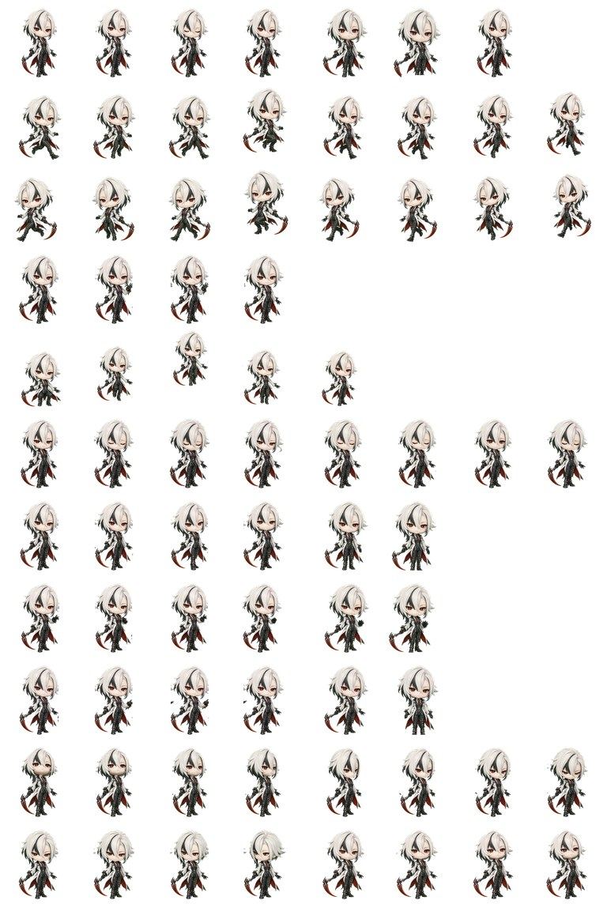

# 阿蕾奇诺 Q 版 · Codex / ChatGPT 桌面版虚拟宠物

一只会站在你 Codex / ChatGPT 桌面版窗口角落里的小人。

装好之后她会待在那儿自己呼吸、眨眼；你让她干活时她进入工作状态，任务跑完她做个完成动作，出错时她会垮下来；鼠标移动的时候她的视线会跟着动。


> 这是**非商业同人作品**，角色版权归米哈游所有，仅供个人使用。和米哈游、OpenAI 都没有关系。


## 先决定装哪一个

仓库里有两套皮肤，画风不同，选一个就行（也可以两个都装）：

| | **持镰版** | **可爱版** |
|---|---|---|
| 长什么样 | 白发、赤瞳、黑红礼服，右手拿一把镰刀 | 黑发礼帽、黑红礼服，黑红色头发 |
| 目录名 | `pets/arlecchino-chibi/` | `pets/arlecchino-chibi-v2/` |
| 应用里显示的名字 | 阿蕾奇诺 | 阿蕾奇诺 原型版 |
| 体积 | 1.77 MB | 1.45 MB |


## 安装

关键要先明白一件事：**虚拟宠物的本质就是一个文件夹。**

ChatGPT桌面应用每次启动时会去 `~/.codex/pets/` 这个目录里翻一遍，谁里面同时有 `pet.json` 和 `spritesheet.webp` 两个文件，谁就是一个可用的宠物。

所以安装的全部工作就一句话：**把 `pets/` 下面那个文件夹，搬到 `~/.codex/pets/` 里面去。**

下面两种做法效果完全一样，任选一个。

### 方法一：手动复制（不用敲命令，推荐）

**第 1 步**　`Download ZIP`，下载完解压。

**第 2 步**　打开解压出来的文件夹，进去找到 `pets` 文件夹。里面有两个子文件夹：`arlecchino-chibi` 和 `arlecchino-chibi-v2`。

**第 3 步**　把你要的那个**子文件夹**复制到下面这个位置（注意：复制子文件夹，不是复制整个 `pets`）：

| 你的系统 | 复制到哪里 |
|---|---|
| Windows | `C:\Users\<你的用户名>\.codex\pets\` |
| macOS / Linux | `~/.codex/pets/` |

Windows 上最快的办法：随便打开一个文件夹窗口，在顶部地址栏里粘贴 `%USERPROFILE%\.codex\pets\` 然后回车，就直接跳过去了。

如果 `.codex` 或 `pets` 这两个文件夹不存在，自己新建一个。**`.codex` 前面的那个点不能漏**，它就是这个文件夹名的一部分。

**第 4 步**　确认层级对不对。最后必须长成这样：

```
~/.codex/pets/arlecchino-chibi/
├── pet.json
└── spritesheet.webp
```


如果变成了 `...\pets\arlecchino-chibi\arlecchino-chibi\pet.json`（多套了一层），就识别不了了。

**第 5 步**　重启ChatGPT

### 方法二：用脚本一键装

前提是本机装了 Git。

**第一步** 执行命令

**Windows**　
进入powershell或git bash（不是cmd）

切换到想要存放的位置，比如说cd D:\workspace

依次运行下面三行命令：

```powershell
# 第 1 行：把仓库整个下载到当前目录
git clone https://github.com/Serein236718/arlecchino-codex-pet.git

# 第 2 行：切到刚下载出来的那个文件夹
cd arlecchino-codex-pet

# 第 3 行：运行安装脚本，它会替你把文件夹复制到位
powershell -ExecutionPolicy Bypass -File .\install.ps1
```

第三行命令解释：

- **`-ExecutionPolicy Bypass` 是干什么的**：Windows 默认不允许运行 `.ps1` 脚本，参数的意思是"这一次放行"
- **本质**：它做的就是把 `pets\<皮肤名>` 复制到 `%USERPROFILE%\.codex\pets\`。脚本只是省了复制粘贴的步骤而已。
- **重复运行会不会出bug**：不会。脚本发现目标位置已经有同名文件夹，会先删掉再复制，所以结果是干净的。

**只装其中一个**，在第 3 行后面加个 `-Pet` 参数：

```powershell
powershell -ExecutionPolicy Bypass -File .\install.ps1 -Pet arlecchino-chibi
```

`-Pet` 后面跟的必须是 `pets/` 里真实存在的文件夹名字，写错会提示 `unknown pet` 并列出可选项。

成功的提示长这样：

```
installed arlecchino-chibi -> C:\Users\你的用户名\.codex\pets\arlecchino-chibi
Done. Fully quit the app (tray icon -> Quit, not just minimize) and relaunch.
```

看到 `installed` 和 `Done.` 就成了。

**macOS / Linux**　同样三行，脚本换成 `install.sh`：

```bash
git clone https://github.com/Serein236718/arlecchino-codex-pet.git
cd arlecchino-codex-pet
bash install.sh                     # 两个都装
bash install.sh arlecchino-chibi    # 只装一个
```

### 第二步：重启应用

> **一定要彻底退出应用再打开。** 点窗口右上角的 × 只是把它最小化到托盘，进程还在跑
>
> 正确做法：右下角托盘里找到它的图标 → 右键 → `Quit` 


### 装完没反应？对照这张表

| 你看到的 | 原因 | 怎么办 |
|---|---|---|
| `git : 无法将“git”项识别为 cmdlet` | 电脑上没装 Git | 改用方法一，或安装 Git |
| `无法加载文件 ... 因为在此系统上禁止运行脚本` | 漏了 `-ExecutionPolicy Bypass` | 补上这个参数重试 |
| `找不到路径` 或 `cd` 报错 | 当前目录里没有那个文件夹 | 用完整路径：`cd C:\Users\<你>\arlecchino-codex-pet` |
| 重启后 Pets 列表里根本没有它 | 只最小化没真正退出；或目录多套了一层 | 托盘右键退出；按第 4 步检查 `pet.json` 的上级目录名 |
| 列表里有名字，但选中后什么都不显示 | `spritesheet.webp` 缺失或复制坏了 | 把整个文件夹删掉，重新复制一遍 |

## 卸载

删掉对应文件夹，重启应用，就干净了，不留任何残留。

macOS / Linux：

```bash
rm -rf ~/.codex/pets/arlecchino-chibi
```

Windows（PowerShell）：

```powershell
Remove-Item -Recurse "$HOME\.codex\pets\arlecchino-chibi"
```

不想用命令，直接在资源管理器里删文件夹也一样。

## 两套皮肤的区别

<div align="center">
  
  
</div>

**持镰版**：11 行动作是逐行单独画的，每个状态都有自己的一套姿势。挥手是真的在挥手，摔倒了是真的垮下去，16 个朝向是真的画了不同角度的侧脸。

**可爱版**：全部 88 格都由同一张正面立绘变形而来 —— 放大缩小、绕脚底倾斜、左右镜像，一步重绘都没有。


| | 持镰版 | 可爱版 |
|---|---|---|
| 挥手、失败这类需要肢体变化的动作 | 有真实的手和身体动作 | 只有整体缩放、歪一下，动作幅度小 |
| 16 个方向的"转头" | 真的换了角度 | 把画面压窄 + 侧倾，做出"转过去了"的错觉，正面图无法凭空变出侧脸 |
| 形象一致性 | 每个姿势略有差异 | 100% 一致，绝不会跑形 |
| 制作成本 | 高，每行都要单独画 | 极低，一张图搞定 |

一句话：想要动作生动选持镰版，想要安静一点选可爱版。

## 想自己做一只？

完全可以。宠物包本质上就是「一张图 + 一个 JSON」，不需要打包、不需要编译。

### 图集长什么样

把 88 张动作图按顺序铺在一张画布上，像一张贴纸板，应用运行时按格子去取。这就是精灵图集（sprite sheet）。这套皮肤用的是 v2 规格：

| 项目 | 要求 |
|---|---|
| 整张画布尺寸 | 1536 × 2288 像素 |
| 网格 | 8 列 × 11 行，共 88 格 |
| 每格大小 | 192 × 208 像素 |
| 背景 | 必须是透明的 |
| `pet.json` 里要写 | `"spriteVersionNumber": 2` |

<p align="center">
  
</p>

每一行对应一个状态，行内第几格就是第几帧：

| 行 | 状态 | 需要几帧 |
|---|---|---|
| 0 | 待机（第 7 格是正面中性帧，用来把视线归零） | 6 + 1 |
| 1 / 2 | 向右跑 / 向左跑 | 8 / 8 |
| 3 | 挥手 | 4 |
| 4 | 跳跃 | 5 |
| 5 | 失败 / 萎靡 | 8 |
| 6 | 等待 | 6 |
| 7 | 工作中 | 6 |
| 8 | 完成展示 | 6 |
| 9 / 10 | 16 个顺时针朝向，每行 8 格，000° → 337.5° | 8 / 8 |

这里有个硬规矩：**一行能放 8 格，但有些状态用不满 8 格，用不满的格子必须留成全透明**，不能拿别的帧去凑数，否则校验会报 `unused column is not transparent`。

### 两个现成的脚本

`tools/` 下的两个脚本可以直接拿来改成你自己的角色（需要 Python 3，外加 Pillow 和 numpy）：

- **`build_atlas.py`** —— 适合"每个状态单独画好一张图"的做法。它负责把一行里的多个姿势切开、去掉背景色、对齐脚底线，再拼成 8×11 图集。
- **`build_from_frame.py`** —— 懒人版：只给一张正面立绘，靠缩放、倾斜、镜像派生出全部 88 格，零重绘。

```bash
python tools/build_from_frame.py --src path/to/你的角色.png --out build/
```

跑完 `build/` 里会出现 `spritesheet.webp` 和 `pet.json`，丢进 `~/.codex/pets/一个新名字/` 里就是一只新宠物。

拼接时还有两个坑，脚本里已经处理好了，但你如果自己写，需要留意：

1. **每行帧数是硬要求**，多余格子必须全透明（见上面那条硬规矩）。
2. **WebP 必须用 `exact=True` 保存**。否则那些全透明的像素会悄悄把 RGB 值写回去，校验会报 `transparent RGB residue`。

## 许可与声明

- 本仓库的脚本和打包代码：MIT 许可，见 [LICENSE](LICENSE)
- 角色「阿蕾奇诺」以及《原神》相关设定，著作权归米哈游（HoYoverse）所有。本仓库的美术素材是**非商业同人作品**，仅供个人使用，请勿商用。详见 [NOTICE.md](NOTICE.md)
- 与米哈游、OpenAI 均无隶属关系，未获官方授权或背书

## English

Custom pet skins for the Codex / ChatGPT desktop app. A pet is just a folder: copy one from `pets/` into `~/.codex/pets/`, fully quit the app from the tray icon (not just minimize), relaunch it, then pick the pet under Settings → Personalization → Pets. No command line needed — the install scripts only copy the folder for you.

`arlecchino-chibi` has hand-made poses for every state; `arlecchino-chibi-v2` is derived from a single front-view illustration using affine transforms only. Both follow the v2 contract: 1536×2288 canvas, 8×11 grid, 192×208 cells, transparent background, `spriteVersionNumber: 2`.

Fan art. Arlecchino and Genshin Impact are © HoYoverse. Non-commercial personal use only. Not affiliated with HoYoverse or OpenAI.
